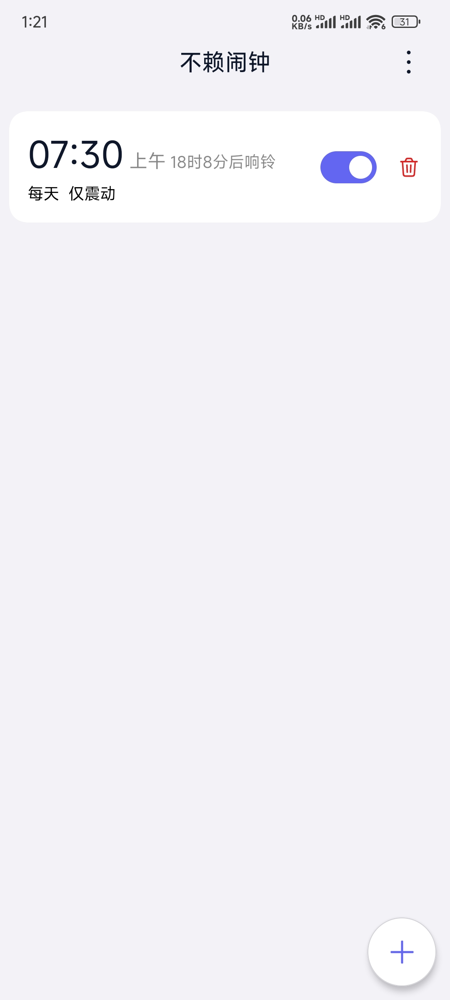
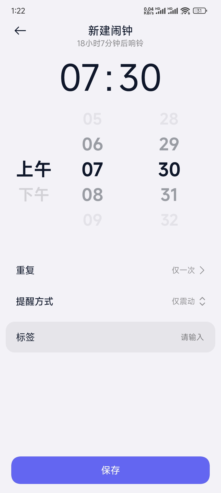
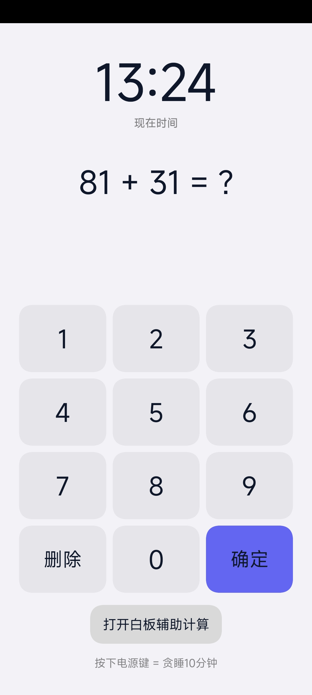
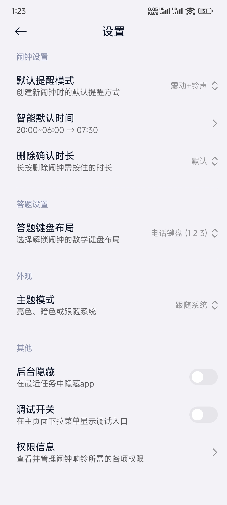
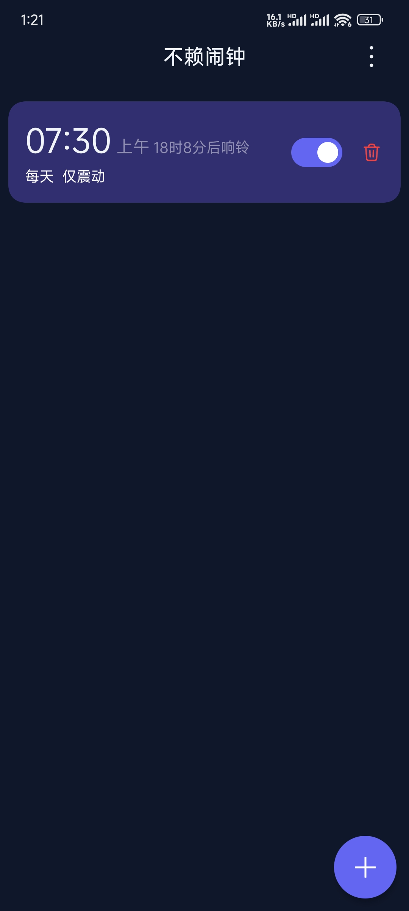
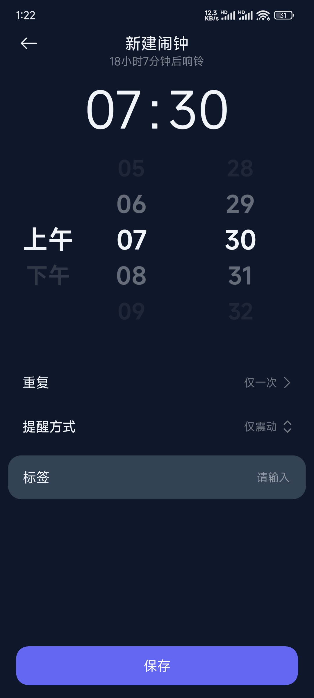
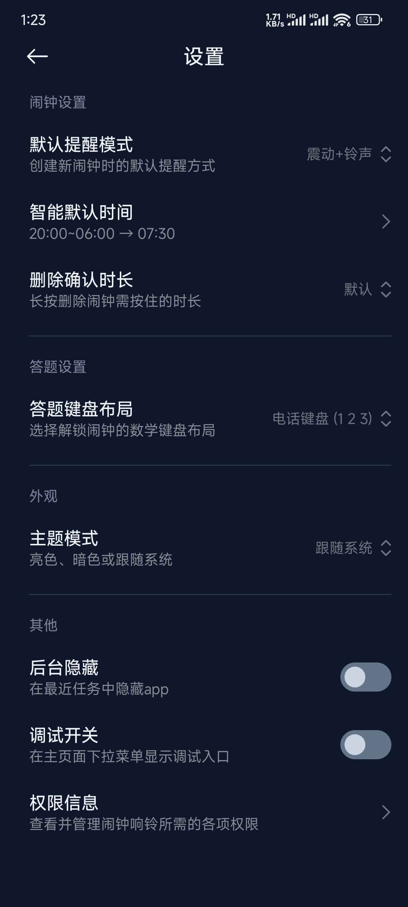

# 不赖闹钟 / NoSlackAlarm

## 简介

**不赖闹钟** 是一款 Android 闹钟应用，核心目标是**真正把你叫醒**。

与"按一下就关"的普通闹钟不同，不赖闹钟在响铃时需要你**答对一道数学题**才能关闭——在你清醒之前，闹钟不会停。它面向容易赖床、习惯性关闹钟继续睡的用户。

应用采用 **Jetpack Compose + Miuix（小米风格 UI）** 构建，界面简洁、本地优先、最小数据收集。

## 应用截图

<div align="center">

  
  
  
  

  
  
  
  

</div>

## 功能特性

- **答题关闭机制**：响铃时须答对算术题才能关闹钟；答错会抖动提示。
- **防赖床检测**：答题关闭后静默观察 30 秒（前 8 秒不计），若没有检测到持续移动（累计不足 6 秒）会再次响铃并标注「防赖床检测」，需重新答题关闭；会一轮接一轮持续，直到检测到持续移动为止（最多 10 轮 / 20 分钟兜底）。默认开启，可在设置中关闭。
- **数学键盘布局可选**：电话键盘（123）或计算器（789）两种布局。
- **白板辅助计算**：响铃页可打开白板手算，避免口算压力。
- **暂停响铃**：按电源键暂停响铃 10 分钟（可配置贪睡次数上限），暂停期间仍可在响铃界面答题关闭，10 分钟后未关闭会自动重新响铃。
- **提醒模式**：仅震动 / 仅铃声 / 震动+铃声。
- **智能默认时间**：在设定的夜间时段内新建闹钟，自动填入预设默认时间。
- **重复日期**：按周设置重复。
- **主题模式**：跟随系统 / 亮色 / 暗色。
- **后台隐藏**：在「最近任务」中隐藏应用。
- **删除确认时长**：长按删除闹钟的按住时长可设为快 / 默认 / 慢，防误删。
- **权限管理**：可点击跳转至系统权限设置。
- **隐私优先**：不收集、不上传任何用户数据；隐私政策与用户协议随应用离线打包。

## 隐私

本应用遵循「本地优先、最小收集」原则：

- 不收集、不上传任何用户数据；
- 闹钟数据仅存储于设备本地（DataStore / Room）；
- 权限仅在本地用于响铃、震动、锁屏显示等必要功能。

## 系统要求

- Android 8.0（API 26）及以上
- 安装包体积较小，无需联网即可使用全部功能

## 从源码构建

环境要求：

- **JDK 21**（Miuix 0.9.4 以 JVM target 21 构建，全部模块统一到 21）
- **Android SDK**（compileSdk / targetSdk = 37）
- **Kotlin 2.4.20**、**Gradle**（使用仓库内 `gradlew` 包装器，无需手动安装）
- Android Studio（推荐）或其他支持 Gradle 的 IDE

构建调试版：

```bash
./gradlew assembleDebug
```

生成的 APK 位于 `app/build/outputs/apk/debug/`。

## 许可证

本项目以 **Apache-2.0** 许可证开源。版权归 **Lorix and Contributors** 所有。许可证详情可查看项目根目录下的[`LICENSE`](LICENSE) 文件。

```
Copyright 2026 Lorix and Contributors

Licensed under the Apache License, Version 2.0 (the "License");
you may not use this file except in compliance with the License.
You may obtain a copy of the License at

    http://www.apache.org/licenses/LICENSE-2.0
```

## 仓库

- **GitHub（主仓库，接收 Issue / PR）**：<https://github.com/lorix-lx/NoSlackAlarm>
- **Gitee（镜像，仅同步代码）**：<https://gitee.com/lorix/NoSlackAlarm>

## 贡献

欢迎通过 GitHub 提交 Issue 与 Pull Request。提交代码前请确保：

所有自有源文件（`.kt` / `.kts` / `.pro`）顶部带有版权头：
```
// Copyright 2026 Lorix and Contributors
// SPDX-License-Identifier: Apache-2.0
```
